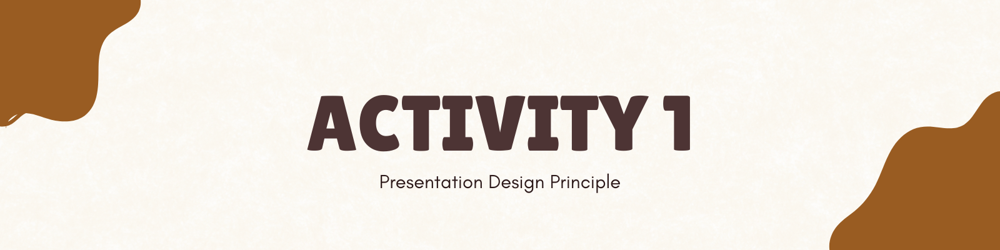
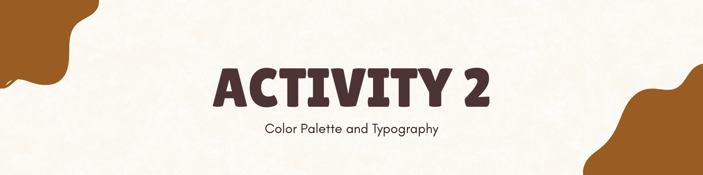
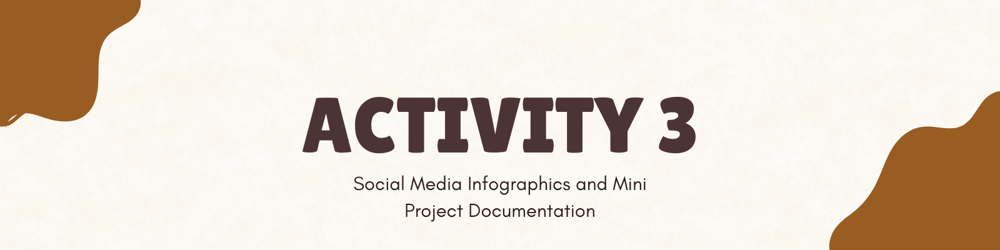
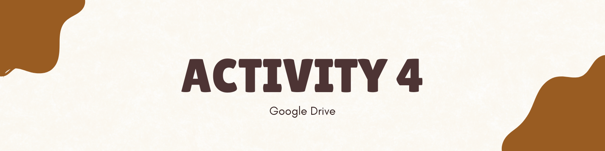
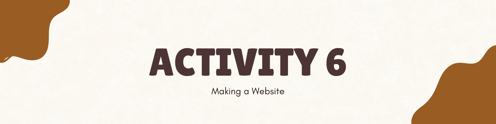
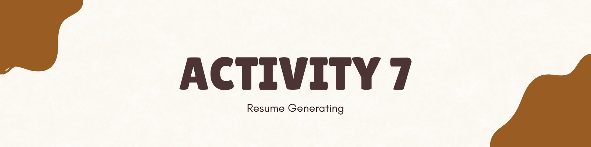

<!-- ================= ABOUT ME ================= -->

 

<!-- ================= TABLE OF CONTENTS ================= -->

# TABLE OF CONTENTS

- [Activity 1 - Presentation Design Principle](#activity-1)
- [Activity 2 - Color Palette and Typography](#activity-2)
- [Activity 3 - Social Media Infographic and Mini Project Documentation](#activity-3)
- [Activity 4 - Google Drive](#activity-4)
- [Activity 5 - AI Tools Activity](#activity-5)
- [Activity 6 - Making a Website](#activity-6)
- [Activity 7 - Resume Generating](#activity-7)

---

<!-- ================= ACTIVITY 1 ================= -->

### Description

This activity focused on using Canva to create a promotional poster for a hypothetical free coffee event. It involved applying visual design principles such as layout, visual hierarchy, readability, and proper presentation of information.

### Activity Output

[**View ACTIVITY1GE4120_ESTOESTA.png**](Activity%201/ACTIVITY1GE4120_ESTOESTA.png)

---

<!-- ================= ACTIVITY 2 ================= -->

### Description

This activity focused on creating a personal branding kit to establish a consistent visual identity. It included designing a personal logo, tagline, color palette, typography, and resume header.

### Activity Output

**Personal Branding Kit**

---

<!-- ================= ACTIVITY 3 ================= -->

### Description

This activity focused on presenting information through a one-page infographic and creating a project documentation report. It involved identifying a real-world problem, presenting relevant information and data, and proposing a technology-based solution.

### Activity Output

**Social Media Infographic**

[**View Infographic_ESTOESTA.png**](Activity%203/Infographic_ESTOESTA.png)

**Mini Project Documentation**

[**View ProjectDocumentation_ESTOESTA.pdf**](Activity%203/ProjectDocumentation_ESTOESTA.pdf)

---

<!-- ================= ACTIVITY 4 ================= -->

### Description

This activity focused on learning how to use Google Drive for storing, organizing, accessing, and sharing files online. It also introduced the use of Google Docs, Sheets, and Slides for collaboration and productivity.

### Activity Output

[**View Google Drive.pdf**](Activity%204/Google%20Drive.pdf)

---

<!-- ================= ACTIVITY 5 ================= -->

### Description

This activity focused on exploring an AI tool by creating an initial prompt, reviewing its generated output, improving the prompt, and comparing the results. It demonstrated how clear and specific instructions can affect the quality of AI-generated responses.

### Activity Output

[**View Activity 5_Estoesta.pdf**](Activity%205/Activity%205_Estoesta.pdf)

---

<!-- ================= ACTIVITY 6 ================= -->

### Description

This activity focused on creating a one-page advocacy website using Replit AI. The website, titled **PAWS & LOVE**, promotes the adoption of stray dogs and encourages people to provide homeless animals with safe and loving homes.

### Activity Output

[**View palanca ni eka.pdf**](Activity%206/palanca%20ni%20eka.pdf)

---

<!-- ================= ACTIVITY 7 ================= -->

### Description

This activity focused on using two different AI tools to generate a professional resume using the same information. The outputs were compared based on their design, content, organization, and overall presentation to determine which resume was more suitable.

### Activity Output

**AI-Generated Resume**

[**View Resume.png**](Activity%207/Resume.png)

---

---

**THANK YOU FOR VISITING MY PORTFOLIO!**

*GE 4120 

**Maryieka B. Estoesta**  
BSN 4F | Ateneo de Davao University

